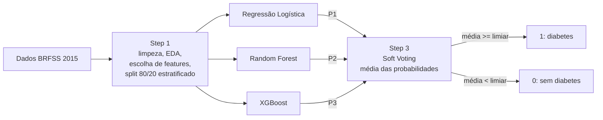
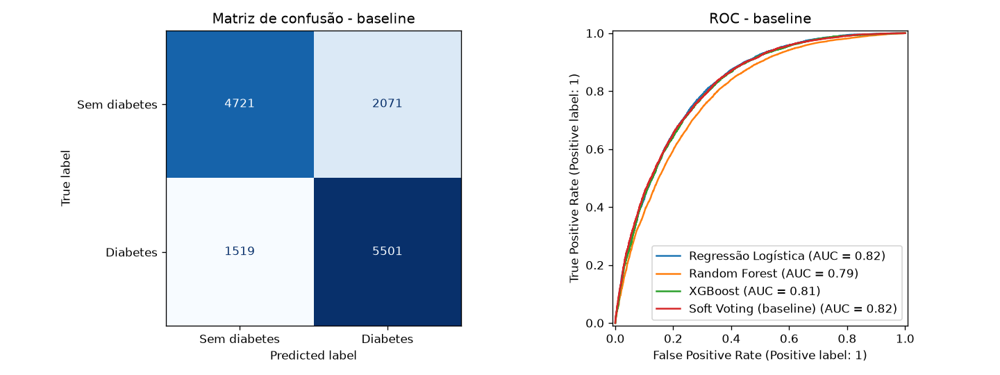
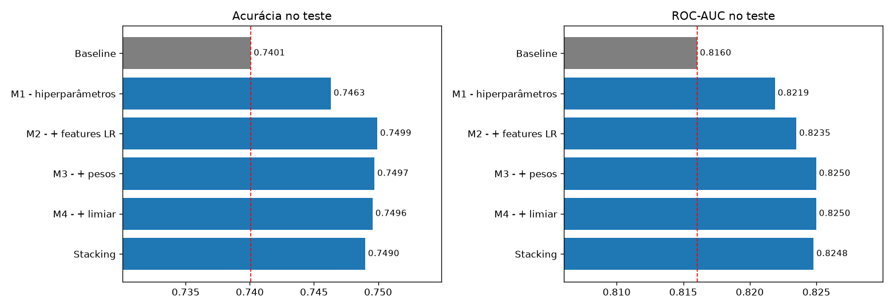

# GlycoVote

**Triagem de risco de diabetes com um ensemble de Soft Voting (Regressão Logística + Random Forest + XGBoost)**


O GlycoVote estima, a partir de 21 indicadores de saúde e estilo de vida autodeclarados (pressão alta, IMC,
colesterol, idade, saúde geral, atividade física...), se uma pessoa tem pré-diabetes ou diabetes. Três modelos de
naturezas diferentes estimam cada um uma probabilidade, e a decisão final sai da média delas (*soft voting*).

O projeto foi feito em duas fases. Primeiro implementamos a arquitetura proposta exatamente como foi desenhada
(o **baseline**). Depois testamos melhorias uma a uma, decidindo tudo com validação cruzada e sem tocar no conjunto
de teste.

| | Acurácia | ROC-AUC |
|---|---|---|
| Baseline (proposta original) | 0,7401 | 0,8160 |
| **GlycoVote final** | **0,7499** | **0,8235** |

> Trabalho da disciplina de Machine Learning 2 (AV2). Projeto acadêmico: **não é uma ferramenta de diagnóstico**.

---

## Sumário

- [Problema e dados](#problema-e-dados)
- [Arquitetura](#arquitetura)
- [Método](#método)
- [Resultados](#resultados)
- [O que aprendemos](#o-que-aprendemos)
- [Como rodar](#como-rodar)
- [Estrutura do repositório](#estrutura-do-repositório)
- [Autores](#autores)

---

## Problema e dados

- **Fonte:** [Diabetes Health Indicators Dataset](https://www.kaggle.com/datasets/alexteboul/diabetes-health-indicators-dataset), Kaggle, construído a partir do BRFSS 2015 (pesquisa telefônica de saúde do CDC, EUA).
- **Arquivo:** `diabetes_binary_5050split_health_indicators_BRFSS2015.csv`, com 70.692 respostas e classes balanceadas 50/50.
- **Alvo:** `Diabetes_binary`, em que 0 = sem diabetes e 1 = pré-diabetes ou diabetes.
- **Features (21):** binárias (HighBP, HighChol, Smoker, Stroke, PhysActivity...), ordinais (GenHlth 1–5, Age em 13 faixas, Education, Income) e numéricas (BMI, MentHlth, PhysHlth).

## Arquitetura



A escolha dos três modelos é proposital: cada um erra de um jeito diferente, e a média só ganha quando os erros não
são os mesmos.

| Modelo | Família | Papel no ensemble |
|---|---|---|
| Regressão Logística | linear | estável, bem calibrado, capta os efeitos principais |
| Random Forest | *bagging* de árvores | interações entre variáveis, baixa variância |
| XGBoost | *boosting* de árvores | relações não lineares, normalmente o mais forte sozinho |

## Método

### Fase 1: baseline (proposta original, implementada fielmente)

1. **Step 1, dados**
   - Não há valores nulos. **1.635 linhas duplicadas (2,3%) foram removidas antes do split**, para que a mesma linha não caísse no treino e no teste ao mesmo tempo.
   - Matriz de correlação: nenhum par de features passa de |r| = 0,55 (GenHlth × PhysHlth), então não há multicolinearidade forte.
   - Influência sobre o alvo: correlação absoluta de cada feature com `Diabetes_binary`, calculada **só no treino**. Ficamos com as 17 features com |r| ≥ 0,05; saíram Fruits, Sex, NoDocbcCost e AnyHealthcare.
   - Split de 80/20 estratificado (`random_state=42`): 55.245 linhas de treino e 13.812 de teste.
2. **Step 2, modelos:** Regressão Logística (com `StandardScaler`), Random Forest e XGBoost, todos com **hiperparâmetros default**, treinados em paralelo (`joblib`).
3. **Step 3, soft voting:** média simples das três probabilidades; média ≥ 0,5 vira classe 1, senão classe 0.

### Fase 2: melhorias

Para que a comparação com o baseline fosse justa, seguimos três regras:

- o mesmo split do baseline;
- **toda decisão** (hiperparâmetros, features, pesos e limiar) foi tomada com **validação cruzada estratificada de 5 folds dentro do treino**, e o teste serviu só para medir;
- as melhorias são **cumulativas**: cada etapa parte da anterior, o que permite medir a contribuição de cada uma.

| Etapa | Modificação | Hipótese |
|---|---|---|
| M1 | Otimização de hiperparâmetros com **Optuna** (TPE, 5-fold, ROC-AUC) | a Random Forest default cresce árvores sem limite e sofre overfitting |
| M2 | **One-hot** das ordinais na Regressão Logística + reavaliar o corte de features | idade, renda e saúde geral não têm efeito linear |
| M3 | **Pesos** no soft voting, otimizados nas probabilidades *out-of-fold* | a média simples dá o mesmo peso a um modelo mais fraco |
| M4 | **Limiar** ajustado nas probabilidades *out-of-fold* | 0,5 talvez não seja o ponto de máxima acurácia |
| Alt. | **Stacking**: Regressão Logística como meta-modelo | aprender a combinação em vez de fixar uma média |

## Resultados

### Baseline

| Modelo (teste) | Acurácia | Precisão | Recall | F1 | ROC-AUC |
|---|---|---|---|---|---|
| Regressão Logística | 0,7439 | 0,7374 | 0,7705 | 0,7536 | 0,8163 |
| Random Forest | 0,7235 | 0,7071 | 0,7783 | 0,7410 | 0,7895 |
| XGBoost | 0,7415 | 0,7269 | 0,7872 | 0,7558 | 0,8130 |
| **Soft Voting (baseline)** | **0,7401** | 0,7265 | 0,7836 | 0,7540 | **0,8160** |



### Evolução das melhorias (teste, cumulativo)

| Etapa | Acurácia | Precisão | Recall | F1 | ROC-AUC | Δ Acurácia | Δ AUC |
|---|---|---|---|---|---|---|---|
| Baseline | 0,7401 | 0,7265 | 0,7836 | 0,7540 | 0,8160 | — | — |
| M1: hiperparâmetros | 0,7463 | 0,7310 | 0,7925 | 0,7605 | 0,8219 | +0,0062 | +0,0058 |
| **M2: + features (final)** | **0,7499** | 0,7349 | 0,7947 | 0,7636 | **0,8235** | **+0,0098** | **+0,0075** |
| M3: + pesos no voting | 0,7497 | 0,7326 | 0,7993 | 0,7645 | 0,8250 | +0,0096 | +0,0089 |
| M4: + limiar (0,485) | 0,7496 | 0,7272 | 0,8117 | 0,7671 | 0,8250 | +0,0095 | +0,0089 |
| Alt.: Stacking | 0,7490 | 0,7357 | 0,7899 | 0,7618 | 0,8248 | +0,0089 | +0,0087 |



### Tempo de execução

Pipeline completo, do CSV até a previsão no teste (sem contar imports e download), medido na última célula do notebook
(Apple Silicon, 10 núcleos):

| | Tempo | Acurácia | ROC-AUC |
|---|---|---|---|
| Baseline | 8,9 s | 0,7401 | 0,8160 |
| GlycoVote final, incluindo a busca de hiperparâmetros | 336,6 s | 0,7499 | 0,8235 |
| GlycoVote final, só o treino (hiperparâmetros já conhecidos) | 9,0 s | 0,7499 | 0,8235 |

Quase todo o custo extra é a busca do Optuna (55 tentativas × 5 folds), que roda uma única vez. Para treinar, o modelo
final custa o mesmo que o baseline.

**Hiperparâmetros encontrados (M1):**

- Regressão Logística: `C=0.031`
- Random Forest: `max_depth=9`, `min_samples_leaf=2`, `max_features=0.28`, `n_estimators=300`
- XGBoost: `n_estimators=750`, `learning_rate=0.0125`, `max_depth=5`, `min_child_weight=3`, `subsample=0.66`, `colsample_bytree=0.63`, `reg_lambda=4.12`

## O que aprendemos

1. **No baseline, o ensemble ficou abaixo do melhor modelo individual.** A Random Forest default (AUC 0,7895)
   decorava o treino e, com peso igual na média, puxava o resultado para baixo. Um ensemble só ganha quando os
   modelos que o compõem são competentes.
2. **Regularizar foi a maior alavanca.** Limitar a profundidade da Random Forest (`max_depth=9`) levou o AUC dela
   de 0,7895 para 0,8189 no teste. Com os três modelos no mesmo nível, a média passou a somar em vez de diluir.
3. **Escolher features por correlação de Pearson atrapalhou.** A validação cruzada mostrou que o corte |r| ≥ 0,05
   piorava os três modelos. Pearson mede só relação linear e de uma variável por vez: `Sex` quase não se correlaciona
   com o alvo isoladamente, mas contribui em interação com as outras. A versão final usa as 21 features.
4. **Otimizar demais vira ruído.** Os pesos ótimos ficaram em (0,05; 0; 0,95), ou seja, o "ensemble" virava só o
   XGBoost, e o stacking chegou à mesma conclusão. Com 13.812 exemplos de teste, o erro-padrão da acurácia é
   ≈ 0,0037, então diferenças de 0,001 entre M2, M3, M4 e stacking não são significativas. Já o ganho de ~0,01 sobre
   o baseline passa de 2,5 erros-padrão.
5. **O limiar é uma decisão de negócio, não de performance.** O limiar ótimo (0,485) não muda a acurácia, só troca
   precisão por recall. Numa triagem real, ele deve ser definido pelo custo de um falso negativo.

**Arquitetura final: M2**, soft voting com média simples dos três modelos otimizados, com todas as features e
one-hot na Regressão Logística. Ela mantém o desenho original (linear + *bagging* + *boosting*) e ganha quase
1 ponto percentual de acurácia.

**Limites e próximos passos:** o teto deste dataset parece estar perto de 0,75 de acurácia e 0,83 de AUC, porque as
variáveis são autodeclaradas e grosseiras (faixas de idade e renda, saúde geral de 1 a 5). Ganhos maiores devem vir
de dados clínicos (glicemia, HbA1c), não de modelos mais complexos.

## Como rodar

```bash
git clone https://github.com/DaviMelooficial/glycovote.git
cd glycovote
python -m venv .venv && source .venv/bin/activate
pip install -r requirements.txt
jupyter notebook notebooks/glycovote.ipynb
```

O dataset é baixado automaticamente pelo `kagglehub` na primeira execução. A otimização com Optuna leva cerca de
5 minutos num notebook de 10 núcleos. Todas as sementes são fixas (`SEED = 42`), então os números acima se reproduzem.

## Estrutura do repositório

```
glycovote/
├── notebooks/
│   └── glycovote.ipynb      # análise completa: baseline, melhorias e conclusões
├── reports/
│   └── figures/             # gráficos usados no README
├── requirements.txt
└── README.md
```

## Autores

- Davi Melo
- Elizabete Barbosa
- Ivan Edward
